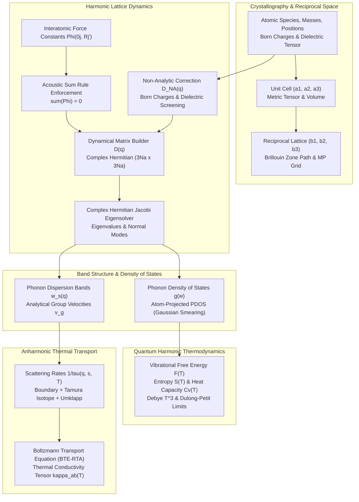

# PhononLattice

[](https://github.com/ZengLLQ/phonon-lattice/actions/workflows/ci.yml)
[](https://opensource.org/licenses/MIT)
[](https://www.rust-lang.org/)

**PhononLattice** is a high-performance computational physics and materials science engine for crystal lattice dynamics, phonon dispersion, polar non-analytic corrections, and anharmonic lattice thermal transport written in modern Rust. It implements a self-contained complex Hermitian eigensolver, exact Acoustic Sum Rule (ASR) enforcement, and solves the Boltzmann Transport Equation (BTE) under the Single-Mode Relaxation Time Approximation (SMRTA) without external C/Fortran LAPACK dependencies.

---

## Architectural Pipeline



---

## Mathematical Formulations

### 1. Harmonic Dynamical Matrix & Acoustic Sum Rule

In the harmonic approximation, the potential energy expansion yields the real-space interatomic force constants (IFCs):

$$\Phi_{\alpha\beta}(0j, \mathbf{R}j') = \left. \frac{\partial^2 V}{\partial u_{\alpha}(0j) \, \partial u_{\beta}(\mathbf{R}j')} \right|_0$$

Translational invariance of crystal space requires rigid translations to produce zero net restoring force. This is guaranteed by the **Acoustic Sum Rule (ASR)**:

$$\Phi_{\alpha\beta}(0j, \mathbf{0}j) = - \sum_{(\mathbf{R}, j') \ne (\mathbf{0}, j)} \Phi_{\alpha\beta}(0j, \mathbf{R}j')$$

Enforcing the ASR guarantees that the three acoustic phonon branches vanish identically at the Brillouin zone center ($\mathbf{q} \to 0$):

$$\lim_{\mathbf{q} \to 0} \omega_s(\mathbf{q}) = 0 \quad (s = 1, 2, 3)$$

At arbitrary wavevector $\mathbf{q}$, the $(3N_a) \times (3N_a)$ complex dynamical matrix is assembled via discrete spatial Fourier transform:

$$D_{\alpha\beta}(j, j'; \mathbf{q}) = \frac{1}{\sqrt{M_j M_{j'}}} \sum_{\mathbf{R}} \Phi_{\alpha\beta}(0j, \mathbf{R}j') e^{i \mathbf{q} \cdot \mathbf{R}}$$

Normal mode frequencies $\omega_s(\mathbf{q})$ and polarization eigenvectors $\mathbf{e}_s(\mathbf{q})$ satisfy:

$$D(\mathbf{q}) \mathbf{e}_s(\mathbf{q}) = \omega_s^2(\mathbf{q}) \mathbf{e}_s(\mathbf{q})$$

---

### 2. Polar Non-Analytic Correction (LO-TO Splitting)

In polar semiconductors and ionic insulators (e.g. GaAs, NaCl), long-range macroscopic longitudinal electric fields induce non-analytical behavior in the dynamical matrix as $\mathbf{q} \to 0$:

$$D_{\alpha\beta}^{\text{NA}}(j, j'; \mathbf{q} \to 0) = \frac{1}{\varepsilon_0 \Omega_0 \sqrt{M_j M_{j'}}} \frac{\left( \sum_\gamma q_\gamma Z_{j, \gamma\alpha}^* \right) \left( \sum_\nu q_\nu Z_{j', \nu\beta}^* \right)}{\sum_{\mu\nu} q_\mu \epsilon_{\mu\nu}^\infty q_\nu} e^{-\frac{q^2}{4\Lambda^2}}$$

where $\Omega_0$ is primitive cell volume, $\mathbf{Z}_j^*$ is the Born effective charge tensor of atom $j$, and $\boldsymbol{\epsilon}^\infty$ is the high-frequency macroscopic dielectric tensor. This macroscopic field splits the longitudinal optical (LO) and transverse optical (TO) branches at $\Gamma$, fulfilling the Lyddane-Sachs-Teller (LST) relation:

$$\frac{\omega_{\text{LO}}}{\omega_{\text{TO}}} = \sqrt{\frac{\epsilon^0}{\epsilon^\infty}}$$

---

### 3. Phonon Density of States (DOS)

The Total Phonon Density of States $g(\omega)$ and atom-projected PDOS $g_j(\omega)$ are integrated over a Monkhorst-Pack reciprocal grid with Gaussian broadening parameter $\sigma$:

$$g(\omega) = \frac{1}{N_{\mathbf{q}}} \sum_{\mathbf{q}, s} \frac{1}{\sigma \sqrt{2\pi}} \exp\left( - \frac{(\omega - \omega_s(\mathbf{q}))^2}{2\sigma^2} \right)$$

$$g_j(\omega) = \frac{1}{N_{\mathbf{q}}} \sum_{\mathbf{q}, s} \left( \sum_{\alpha=0}^2 |e_{3j+\alpha}(\mathbf{q}s)|^2 \right) \frac{1}{\sigma \sqrt{2\pi}} \exp\left( - \frac{(\omega - \omega_s(\mathbf{q}))^2}{2\sigma^2} \right)$$

Satisfying the fundamental state conservation theorem:

$$\int_0^\infty g(\omega) \, d\omega = 3 N_a, \quad \sum_{j=0}^{N_a-1} g_j(\omega) = g(\omega)$$

---

### 4. Quantum Harmonic Thermodynamics

Given mode frequencies $\omega_{\mathbf{q}s}$, the vibrational partition function provides the macroscopic thermodynamic functions:

- **Zero-Point Energy (ZPE):**
  $$E_{\text{ZPE}} = \frac{1}{2} \sum_{\mathbf{q}, s} \hbar \omega_{\mathbf{q}s}$$

- **Vibrational Free Energy:**
  $$F_{\text{vib}}(T) = E_{\text{ZPE}} + k_B T \sum_{\mathbf{q}, s} \ln\left( 1 - e^{-\frac{\hbar \omega_{\mathbf{q}s}}{k_B T}} \right)$$

- **Constant-Volume Heat Capacity:**
  $$C_v(T) = k_B \sum_{\mathbf{q}, s} \left( \frac{\hbar \omega_{\mathbf{q}s}}{k_B T} \right)^2 \frac{e^{\frac{\hbar \omega_{\mathbf{q}s}}{k_B T}}}{\left( e^{\frac{\hbar \omega_{\mathbf{q}s}}{k_B T}} - 1 \right)^2}$$

At $T \to 0$, $C_v(T) \propto T^3$ (Debye $T^3$ law), and at $T \to \infty$, $C_v(T) \to 3 N_a k_B$ (Dulong-Petit law).

---

### 5. Anharmonic Thermal Transport (Boltzmann Transport Equation)

Under the Single-Mode Relaxation Time Approximation (SMRTA), the lattice thermal conductivity tensor $\boldsymbol{\kappa}$ is evaluated as:

$$\kappa_{\alpha\beta}(T) = \frac{1}{\Omega_0 N_{\mathbf{q}}} \sum_{\mathbf{q}, s} C_v(\mathbf{q}s, T) \, v_{g,\alpha}(\mathbf{q}s) \, v_{g,\beta}(\mathbf{q}s) \, \tau(\mathbf{q}s, T)$$

Phonon group velocities are determined analytically via Hellmann-Feynman perturbation:

$$\mathbf{v}_{g,s}(\mathbf{q}) = \nabla_{\mathbf{q}} \omega_s(\mathbf{q}) = \frac{1}{2\omega_s(\mathbf{q})} \mathbf{e}_s^\dagger(\mathbf{q}) \left[ \nabla_{\mathbf{q}} D(\mathbf{q}) \right] \mathbf{e}_s(\mathbf{q})$$

The total relaxation rate $\tau^{-1}$ combines three dominant microscopic scattering processes via Matthiessen's rule:

$$\frac{1}{\tau(\mathbf{q}s, T)} = \frac{1}{\tau_B} + \frac{1}{\tau_{\text{iso}}} + \frac{1}{\tau_U}$$

1. **Boundary Scattering:** $\tau_B^{-1} = \frac{|\mathbf{v}_{g,s}|}{L_{\text{boundary}}}$
2. **Isotope Mass Disorder (Tamura Formula):** $\tau_{\text{iso}}^{-1} = \frac{\pi}{2} g_2 \frac{\omega^4}{\omega_D^3}$ where $g_2 = \sum_i f_i (1 - M_i / \bar{M})^2$
3. **Anharmonic 3-Phonon Umklapp (Klemens-Callaway):**
   $$\tau_U^{-1} = 2 \gamma^2 \left( \frac{k_B T}{\bar{M} v_s^2} \right) \left( \frac{\omega^2}{\omega_D} \right) \exp\left( - \frac{\Theta_D}{3 T} \right)$$

---

## Materials Catalog

| Material | Structure | Atoms/Cell | Characteristic Phonon Features |
| :--- | :--- | :---: | :--- |
| **Silicon (Si)** | Diamond Cubic (FCC) | 2 | Triply degenerate optical branch at $\Gamma \approx 15.6\text{ THz}$ ($520\text{ cm}^{-1}$), room-temperature thermal conductivity $\kappa \approx 140-168\text{ W}/(\text{m}\cdot\text{K})$. |
| **Graphene** | 2D Honeycomb | 2 | Out-of-plane flexural acoustic branch ($\omega_{\text{ZA}} \propto q^2$), high-frequency optical $G$-band mode $\approx 47.5\text{ THz}$ ($1580\text{ cm}^{-1}$). |
| **Gallium Arsenide (GaAs)** | Zincblende (Polar) | 2 | Non-analytic LO-TO splitting at $\Gamma$ ($\omega_{\text{TO}} \approx 8.02\text{ THz}, \omega_{\text{LO}} \approx 8.75\text{ THz}$) driven by $Z^* = \pm 2.18$. |
| **Sodium Chloride (NaCl)** | Rocksalt (Ionic) | 2 | Strong ionic Coulomb splitting at $\Gamma$ ($\omega_{\text{TO}} \approx 4.9\text{ THz}, \omega_{\text{LO}} \approx 7.8\text{ THz}$) with dynamic screening $\epsilon^\infty = 2.34$. |

---

## Installation & CLI Usage

### Build from Source
```bash
git clone https://github.com/ZengLLQ/phonon-lattice.git
cd phonon-lattice
cargo build --release
```

### CLI Subcommands

#### 1. Phonon Band Dispersion
Compute and display ASCII dispersion curves along high-symmetry Brillouin zone paths:
```bash
cargo run --release -- dispersion silicon
cargo run --release -- dispersion gaas
cargo run --release -- dispersion graphene
cargo run --release -- dispersion nacl
```

#### 2. Phonon Density of States (DOS)
Compute total and atom-projected DOS across a uniform reciprocal Monkhorst-Pack grid:
```bash
cargo run --release -- dos silicon
```

#### 3. Quantum Harmonic Thermodynamics
Scan heat capacity $C_v(T)$, Helmholtz free energy $F(T)$, and entropy $S(T)$ across temperatures:
```bash
cargo run --release -- thermo silicon 50 1000
```

#### 4. BTE Lattice Thermal Conductivity
Solve the Boltzmann Transport Equation for lattice thermal conductivity tensor $\kappa_{\alpha\beta}(T)$ and scattering rates:
```bash
cargo run --release -- bte silicon 300
```

#### 5. Numerical Performance Benchmark
Measure dynamical matrix assembly throughput and Jacobi complex Hermitian diagonalizations/sec:
```bash
cargo run --release -- benchmark
```

---

## Running Test Suites

Execute all unit, integration, and physics invariant tests:

```bash
cargo test --verbose
```

All 15 test suites verify mathematical invariants including ASR translational invariance, matrix Hermiticity, reciprocal orthogonality, Dulong-Petit high-T limits, and Umklapp thermal decay.

---

## Zero External C/Fortran Dependencies

PhononLattice implements its own complex Hermitian Jacobi eigensolver, matrix arithmetic, and numerical integration in pure, safe Rust. It compiles cleanly on any platform without requiring OpenBLAS, LAPACK, or MKL C/Fortran binaries.

---

## License

This project is licensed under the [MIT License](LICENSE).
